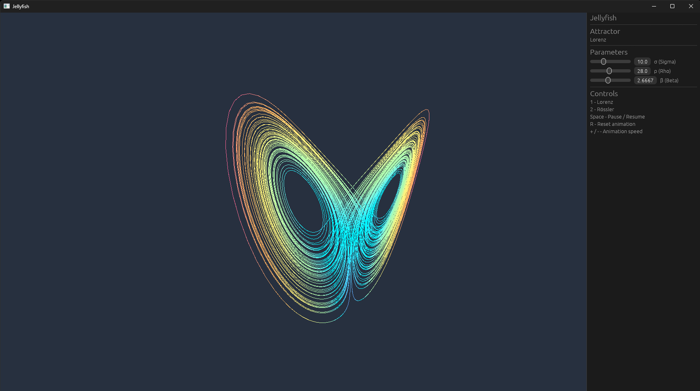
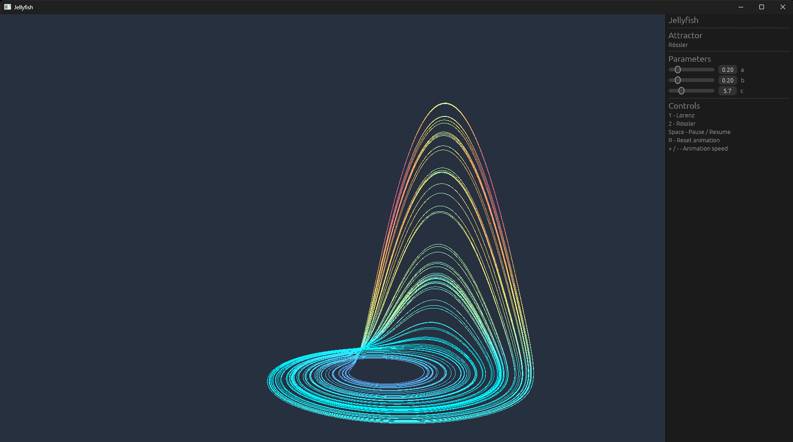

### Jellyfish - strange attractor visualizer (maybe)

In this project, I implemented the mathematical models of two attractors (Lorenz and Rössler). Also implemented a free camera and line based render method, as shown in the images below (yes, without anti-aliasing)





### REQ

Latest ver of Rust and hands (optional)

### How to run

``` 
cargo run --release --bin window 
```

### Plans for this project

1. Add Sprott attractors
2. Volumetric density rendering
3. ~~Death~~
4. Add anti-aliasing
5. Uhh... Emm, idk

### Contributing (most important part)

I'd like to work on this proj with somebody. Cuz I'm not a professional in Rust / Graphics 

### Main idea

Create an intereactive real-time visualizer with diff rendering methods
